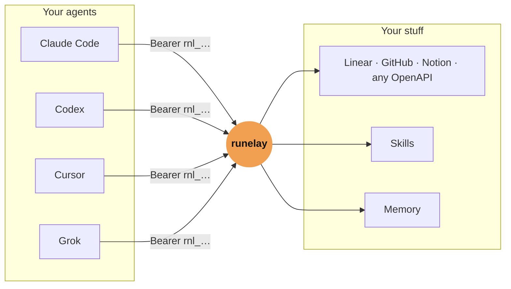
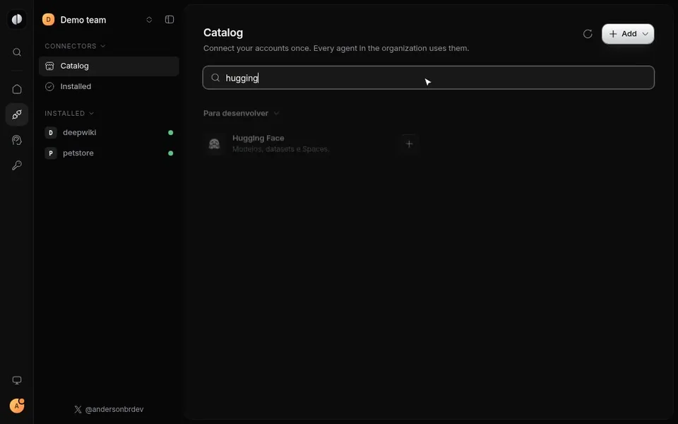
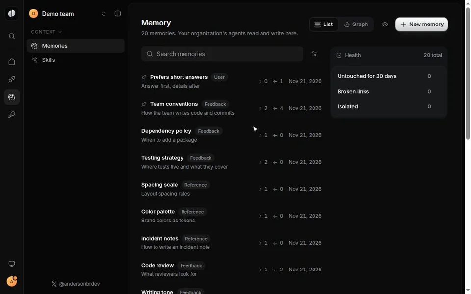
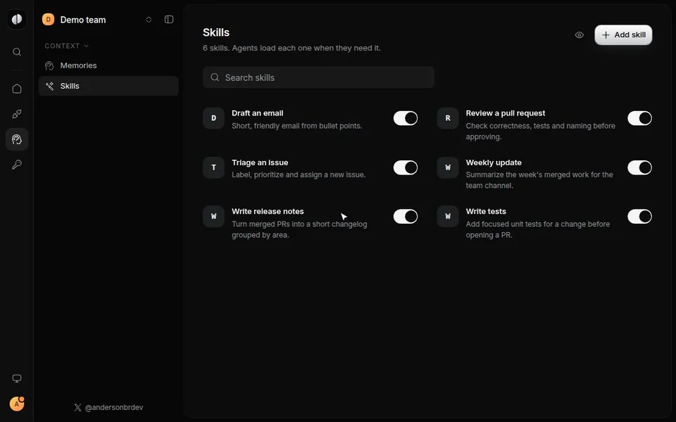
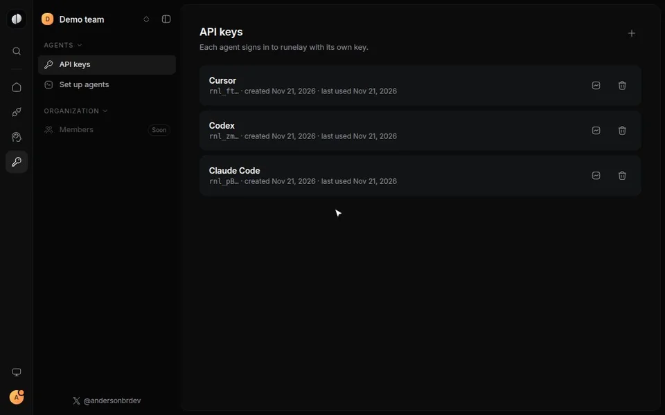
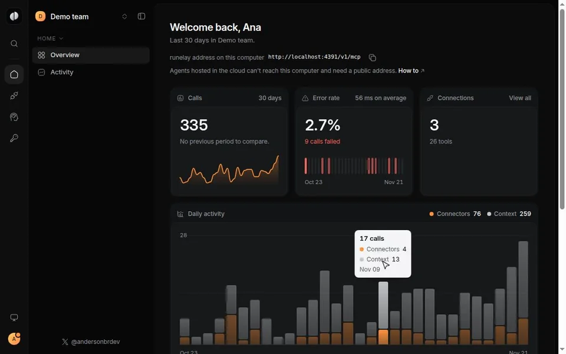
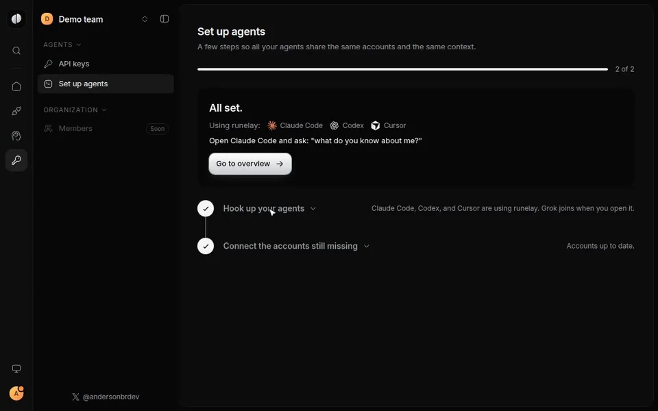

<picture>
  <source media="(prefers-color-scheme: dark)" srcset=".github/assets/banner-dark.svg" />
  
</picture>

<p align="center">
  
  
  
  
  
</p>

<p align="center"><a href="https://runelay.com">runelay.com</a></p>

<p align="center">
  Connect Linear, GitHub and Notion <b>once</b>. Bring the skills and memories you already have.<br />
  Claude Code, Codex, Cursor, Antigravity and Grokbot all see the same tools and the same context, from <b>your</b> server.
</p>

<p align="center">
  <a href="#-quick-start"><b>Quick start</b></a> ·
  <a href="#-connect-your-agents"><b>Connect agents</b></a> ·
  <a href="https://docs.runelay.com"><b>Docs</b></a> ·
  <a href="https://x.com/andersonbrdev"><b>Follow the build</b></a> ·
  <a href="https://github.com/sponsors/Andsu-dev"><b>☕ Support</b></a>
</p>

<br />

<p align="center">
  <picture>
    <source media="(prefers-color-scheme: dark)" srcset=".github/assets/dark-overview.webp" />
    
  </picture>
</p>

## ✨ Why

Every agent lives on its own island. You log into Linear four times, copy the same skill to four folders, and teach Claude a rule that Codex never hears about.

runelay is the bridge: **one MCP endpoint, on your server**, in front of every account, skill and memory. It runs no model. Your agent thinks; runelay is where it finds tools and context.



## 🧩 What you get

| | |
|---|---|
| 🔌 **Connect once** | ~25 curated MCP servers with one-click OAuth, plus any remote MCP, local MCP or OpenAPI spec. |
| 🧠 **Shared memory** | Notes linked with `[[slug]]`, versioned, with health checks. What one agent learns, all of them know. |
| 📚 **Skills that travel** | Your `SKILL.md` folders, searchable and served on demand. |
| 📥 **Import in one go** | Memories, skills and instructions from Claude Code, Codex, Cursor, Grok, Gemini and OpenCode. |
| 🔑 **One key per agent** | Revoke one without touching the others. Every call audited. |
| 🏠 **Yours** | One container, SQLite, no third-party services. MIT. |

## 🎬 Features

<table>
<tr>
<td width="45%">
<h3>Connect once, every agent gets it</h3>
<p>Search the catalog and install a connector with one click. Public ones are ready right away, the rest ask for an OAuth sign-in once. Every agent in the organization sees its tools.</p>
<p><a href="https://docs.runelay.com/connections/">Docs →</a></p>
</td>
<td></td>
</tr>
<tr>
<td width="45%">
<h3>Memory your agents share</h3>
<p>Notes linked with <code>[[slug]]</code>, versioned and checked for broken links or isolated notes. Switch to the graph to see how they connect.</p>
<p><a href="https://docs.runelay.com/memories-and-skills/">Docs →</a></p>
</td>
<td></td>
</tr>
<tr>
<td width="45%">
<h3>Skills that travel</h3>
<p>Your <code>SKILL.md</code> folders in one place. Turn a skill off without deleting it, open it to read or edit the instructions.</p>
<p><a href="https://docs.runelay.com/memories-and-skills/#skills">Docs →</a></p>
</td>
<td></td>
</tr>
<tr>
<td width="45%">
<h3>One key per agent</h3>
<p>Create a key for each agent and get its config ready to paste for Claude Code, Codex, Grok and Cursor. Revoke one without touching the others.</p>
<p><a href="https://docs.runelay.com/connect-agents/">Docs →</a></p>
</td>
<td></td>
</tr>
<tr>
<td width="45%">
<h3>See what your agents use</h3>
<p>Calls, error rate and daily activity on the overview. The activity log shows every tool call, live, filtered by agent or connector.</p>
<p><a href="https://docs.runelay.com/security/#abuse-and-visibility">Docs →</a></p>
</td>
<td></td>
</tr>
<tr>
<td width="45%">
<h3>Hook up every agent in one command</h3>
<p>The setup guide gives you one command that installs the CLI, signs in through the browser and wires every agent on the computer. Each one gets a check when it is using runelay.</p>
<p><a href="https://docs.runelay.com/cli/#setup">Docs →</a></p>
</td>
<td></td>
</tr>
</table>

## 🚀 Quick start

```sh
curl -fsSL runelay.com/install | sh
```

That is it. The script creates `~/runelay`, writes a `.env` with a fresh `RUNELAY_SECRET`, pulls the image and starts it on `127.0.0.1:4312`. Open the link it prints, create your account and follow **Acesso → Configurar agentes**.

### Or the desktop app

No Docker needed: grab runelay for [Mac (Apple silicon)](https://runelay.com/download/mac), [Mac (Intel)](https://runelay.com/download/mac-intel), [Windows](https://runelay.com/download/windows) or [Linux](https://runelay.com/download/linux) (AppImage, also for [arm64](https://runelay.com/download/linux-arm)). The app runs the same server on `127.0.0.1:4312`, so the CLI and your agents find it on their own. Data lives in the app folder (`~/Library/Application Support/runelay` on Mac); the secret is kept in the system keychain when one is available.

The builds are not signed yet. On Mac, right-click the app and choose **Open** the first time. On Windows, choose **More info → Run anyway**. Keep the app running while your agents use it; quitting it stops the server.

### Migrate in one command

On the computer where your agents live:

```sh
curl -fsSL runelay.com/cli | sh
runelay migrate
```

`migrate` logs in through the browser if needed, then reads Claude Code, Codex, Cursor, Grok, Gemini and OpenCode: MCP servers, memories, skills and global instructions. It shows a summary per agent, asks once and sends everything.

Some accounts come connected, others ask for login, and local command servers stay on the agent. What each agent brings: [Migrate from your agents](https://docs.runelay.com/migrate/).

Installer options, Docker Compose by hand, building from source, HTTPS and environment variables: [Self-hosting](https://docs.runelay.com/self-hosting/).

## 🤖 Connect your agents

1. In the panel, open **Acesso → Configurar agentes**. The guide walks you through connecting accounts, creating a key and wiring each client.
2. Or paste the config yourself (replace the URL and key):

**Claude Code**

```sh
claude mcp add --scope user --transport http runelay https://runelay.example.com/v1/mcp \
  --header "Authorization: Bearer rnl_..."
```

Codex, Grok and Cursor configs: [Connect agents](https://docs.runelay.com/connect-agents/).

**All of them at once** with the CLI (see below): `runelay login`, then `runelay connect`.

## 📥 Bring your context

The `runelay` CLI runs on your computer, because that is where your agents keep their files. Install it, log in through the browser, done: no env vars, no keys to copy.

```sh
curl -fsSL runelay.com/cli | sh

runelay login      # finds your server, opens the browser, saves this computer's key
runelay status     # server, organization and what is stored in it
runelay open       # opens the dashboard in the browser
runelay push       # memories, skills and global instructions from every installed agent
runelay pull       # brief into CLAUDE.md and AGENTS.md, new skills into ~/.claude/skills
runelay sync       # push, then pull
runelay connect    # registers the runelay MCP in Claude Code, Codex, Cursor and Grok
runelay import     # MCP servers from Claude, Codex, Grok and Cursor configs become connections
runelay logout     # revokes this computer's key and clears the config
```

Every command, CI usage and what `push` reads from each agent: [CLI](https://docs.runelay.com/cli/) and [Memories and skills](https://docs.runelay.com/memories-and-skills/).

## 📖 Docs

Everything else lives at **[docs.runelay.com](https://docs.runelay.com)**:

- [MCP tools](https://docs.runelay.com/mcp-tools/) and [REST API](https://docs.runelay.com/rest-api/)
- [🔒 Security](https://docs.runelay.com/security/)
- [Operations: backup, update, health](https://docs.runelay.com/operations/)
- [Integrations](https://docs.runelay.com/integrations/) and [Desktop app](https://docs.runelay.com/desktop-app/)
- [Troubleshooting](https://docs.runelay.com/troubleshooting/) and [FAQ](https://docs.runelay.com/faq/)
- [Development](https://docs.runelay.com/development/)

## 🗺️ Roadmap

- Tools page with per-tool approval policies
- Organization members and invites
- Activity log per API key
- Menu bar app for macOS (reconnect alerts)

## ☕ Support runelay

runelay is free, MIT licensed and built by one person. If it saves you time, sponsoring it on GitHub keeps it alive: [github.com/sponsors/Andsu-dev](https://github.com/sponsors/Andsu-dev).

<br />

<p align="center">
  MIT · made by <a href="https://x.com/andersonbrdev"><b>@andersonbrdev</b></a> · <a href="https://runelay.com">runelay.com</a>. Follow the build on X.
</p>
